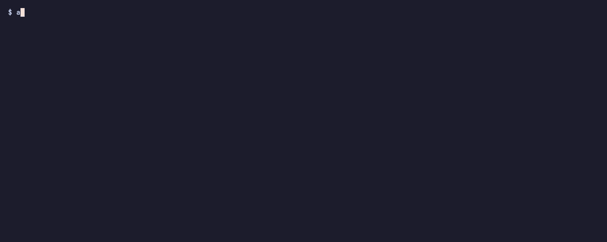

# agents-top

A `top` for coding-agent sessions. If you keep several Claude Code sessions and
Codex runs going at once, `agents-top` shows them all in one terminal view:
which ones are working, which are waiting on you, how full each context is, and
which are about to fight over the same browser.



<sub>The demo uses made-up sessions (`scripts/demo.js` runs the real CLI on synthetic data).</sub>

## What it shows

For each Claude Code session:

- **state**: ● working now, ⚠ a tool call is waiting (for 30s or more), ◌ idle
- **where**: process id, working directory, git branch, `[-p]` for headless runs
- **model**, **context size** (yellow over 120k tokens, red over 180k) and **output tokens**
- **tool**: the one running now (cyan) or the last one used (dim), with `perm?`
  when it looks stuck on a permission prompt (a guess, see below)
- **title**: Claude Code's own title for the conversation

Below that, every Codex CLI process (and Codex inside the ChatGPT desktop app)
with its directory and sandbox mode, and any `claude remote-control` hosts. A
warning line appears when two sessions have recently driven the shared Chrome
browser (claude-in-chrome) or computer use.

It's read-only: it never writes to transcripts, signals processes or touches the
network.

## Install

Needs Node.js 18+ (or Bun) on macOS or Linux.

```sh
npm install -g github:Neilsmahajan/agents-top
# or
bun add -g github:Neilsmahajan/agents-top
```

Or run it from a clone:

```sh
git clone https://github.com/Neilsmahajan/agents-top.git
ln -s "$PWD/agents-top/bin/agents-top.js" ~/.local/bin/agents-top
```

## Usage

```sh
agents-top            # one snapshot
agents-top -w         # live view, refreshed every 2s (q or Ctrl-C to quit)
agents-top -w 5       # every 5s
agents-top --json     # one snapshot as JSON, for scripts
agents-top --help     # columns, heuristics, exit codes
```

Claude Code transcripts are read from `~/.claude/projects`, or from
`$CLAUDE_CONFIG_DIR/projects` if you set `CLAUDE_CONFIG_DIR`. Set `NO_COLOR` to
turn off color.

## What each provider reports

agents-top finds agents by their process, then reads whatever local session
data it understands. Today only Claude Code transcripts are parsed, so Codex
gets less detail.

|                                    | Claude Code             | Codex (CLI and ChatGPT app) | Cursor |
| ---------------------------------- | ----------------------- | --------------------------- | ------ |
| Running sessions                   | yes                     | yes                         | no     |
| Working directory, uptime, CPU     | yes                     | yes                         | no     |
| Sandbox mode                       | n/a                     | yes, from `--sandbox`       | no     |
| Model                              | yes                     | no                          | no     |
| Context and output tokens          | yes                     | no                          | no     |
| Current or last tool               | yes                     | no                          | no     |
| Title, git branch, permission mode | yes                     | no                          | no     |
| Working / waiting / idle state     | yes (heuristic)         | no                          | no     |
| Possible permission prompt         | yes (heuristic)         | no                          | no     |
| Shared Chrome / computer-use use   | yes (heuristic)         | no                          | no     |

Codex metrics from its session files and a Cursor adapter would be welcome
additions.

## What's a guess

Some of what agents-top shows is inferred. These are labeled in `--help` and in
the JSON schema as well:

- **`perm?` (possible permission prompt):** a tool call has had no result for
  over 60 seconds. That's often Claude Code waiting for you to approve it, but a
  slow build or test run looks exactly the same. It's never shown in
  `bypassPermissions` mode (which doesn't prompt) or for `AskUserQuestion`.
- **State (● ⚠ ◌):** based on when the session's transcript file last changed:
  under 30 seconds is "working", and a pending tool call after that is "waiting".
- **Transcript match (`≈` after the directory):** when Claude Code was started
  with `--session-id`, the match is exact. Otherwise agents-top uses the newest
  transcript in that directory that no other session has claimed, so two
  sessions started in the same directory can be swapped.
- **Shared Chrome / computer-use warnings:** sessions that called those tools in
  the last 15 minutes or are waiting on one now. Two or more may get in each
  other's way; it doesn't know whether they actually did.

Exact values: process data (from `ps` and `lsof` or `/proc`), and the model,
token counts, tools, title and branch as recorded in the transcript. Context is
the size of the last request; output tokens include subagent turns written to the
same transcript.

## Works with coding agents

agents-top is also built to be called by agents, so one session can check on
the others:

- `agents-top --json` prints one snapshot in a
  [versioned schema](schema/agents-top.v1.schema.json) (`schemaVersion: 1`).
  Fields can be added within version 1; removing or changing one bumps it.
- Results go to stdout and diagnostics to stderr.
- Exit codes: `0` success (also when no agents are running), `1` runtime error,
  `2` usage error.
- When stdout isn't a terminal there's no color, no prompt and no live view:
  `-w` prints one snapshot and says so on stderr.
- [`SKILL.md`](SKILL.md) tells an agent when and how to use it. Copy it to
  `~/.claude/skills/agents-top/SKILL.md` (Claude Code) or
  `~/.agents/skills/agents-top/SKILL.md` (Codex and others).

## Development

```sh
bun install
bun test              # unit tests on synthetic transcripts, plus an end-to-end run
bun run lint          # Biome
node scripts/smoke-node.mjs
node scripts/demo.js  # the demo data; `vhs docs/demo.tape` re-records the GIF
```

The fixtures in `test/fixtures` are synthetic. Please don't add real transcripts:
they contain your prompts, file contents and paths.

## License

[MIT](LICENSE)
